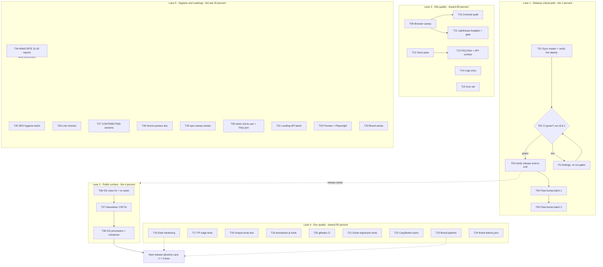

# Pareto Execution Plan — Release, Fleet, and Site Quality

**Created:** 2026-11-04 02:12 CET
**Author:** docs-health session (post-audit)
**Universe:** every open TODO — the 20 rows of `TODO_LIST.md` (rebuilt 2026-11-03), the 50-item next-tasks list in `docs/status/2026-11-04_02-06…`, and the ROADMAP raw ideas those route to. Nothing open is left unplanned; tier-4 items are planned as bounded batches, not TODO_LIST spam (docs-health anti-pattern).
**Ground truth at planning time:** brand + docs **already deployed** (Website run success 2026-11-03 23:26:55Z — the path-filter fix fired); 2 doc commits unpushed; `v0.6.1` uncut; 22 importer repos enumerated; BuildFlow/CI green locally.

---

## 1. Pareto analysis — what actually moves the needle

| Tier                 | Deliverable                                                                                                                                               | Why it carries the value                                                                                                                                                                                                                                                                                                      |
| -------------------- | --------------------------------------------------------------------------------------------------------------------------------------------------------- | ----------------------------------------------------------------------------------------------------------------------------------------------------------------------------------------------------------------------------------------------------------------------------------------------------------------------------- |
| **1% → 51%**         | **Release chain: sync master → cut `v0.6.1` → verify end-to-end**                                                                                         | Ships the temp-file-leak fix (a correctness bug in a data-integrity library!), the brand, and the CI hardening to the module proxy + pkg.go.dev. Every other improvement is invisible until a release exists. The deploy already proved the pipeline; the release is the single gate all consumer value flows through.        |
| **4% → 64%**         | **+ Fleet bump (22 repos) + OG voice fix + newsletter CSP + OG preview test**                                                                             | The fleet bump multiplies the release across 22 consumer codebases — the largest absolute reach in the plan. The OG tagline still says "TOCTOU-safe" (pre-09-18 voice) on every social share, and the newsletter form has likely been dead since the CSP shipped (v0.4.0) — both are public-facing correctness, cheap to fix. |
| **20% → 80%**        | **+ Browser/contrast/Lighthouse verification + brand system batch + build-gate hardening + voice pass + FAQ links + logo a11y + the Go edge tests**       | Converts "it builds" into "it is verified": the site has never been browser-swept, budgets are arbitrary numbers, and the parity gate is a regex. This tier closes every known verification gap on the public surface and hardens the gates that caught this year's bugs.                                                     |
| **final 20% → 100%** | **+ hygiene batch, link checker, gitleaks, CONTRIBUTING, secret posture, sweep tracker, CopyButton, script tests, icons, SEO meta, ROADMAP-fuel batches** | Real but deferrable: no known user harm, no known bug — completeness and professionalism. Planned as bounded batches so they cost hours, not sprawl.                                                                                                                                                                          |

**Anti-Pareto warning (Verschlimmbesser guard):** do NOT let tier-4 breadth delay the tier-1 release. The plan's graph below is a strict two-lane dependency: the release lane blocks the fleet lane; the quality lanes run in parallel and ride the _next_ release.

---

## 2. Task plan — 30–100 min each, ALL TODOs, sorted by tier → customer value → effort

Sort key: **Tier** (1=release lane, 2=public surface, 3=quality, 4=hygiene/roadmap) → **Value** (customer-visible impact) → **Effort** (S/M/L as 30/60/90 min blocks).

| #   | Tier | Task                                                                                                                                                                                                                      | Value  | Eff. | Covers (TODO_LIST / status-report refs) |
| --- | ---- | ------------------------------------------------------------------------------------------------------------------------------------------------------------------------------------------------------------------------- | ------ | ---- | --------------------------------------- |
| T01 | 1    | Sync master + verify the live deployment (brand, benchmarks, changelog, OG fetch)                                                                                                                                         | High   | 45m  | TODO deploy row; f.2                    |
| T02 | 1    | Cut `v0.6.1` (checklist steps 1–9; changelog section BEFORE tag)                                                                                                                                                          | High   | 60m  | TODO High row; f.1                      |
| T03 | 1    | Verify release end-to-end (pkg.go.dev, scratch `go get`, live changelog page, GitHub release notes)                                                                                                                       | High   | 30m  | f.3; checklist step 7–8                 |
| T04 | 1    | Fleet bump batch 1 (11 repos: crm, BuildFlow, CV, .hermes, mr-sync, go-auto-upgrade, go-version-auto-configure, golangci-lint-auto-configure, samber-do-auditlog, go-workflow-auditlog, project-meta)                     | High   | 90m  | TODO fleet row; f.4                     |
| T05 | 1    | Fleet bump batch 2 (11 repos: library-policy, index, clean-wizard, ArtCode, securitymd, linter-autoconfigure-sdk, DiscordSync, dependabot-auto-configure, media-atlas, samber-linter, go-checker-helpers) + fleet summary | High   | 90m  | TODO fleet row; f.4                     |
| T06 | 2    | OG generator voice fix ("TOCTOU-safe" → consequence voice; pkg.go.dev CTA) + re-raster                                                                                                                                    | High   | 45m  | TODO OG row; f.20                       |
| T07 | 2    | Newsletter CSP: reproduce Buttondown block, fix (`form-action` header/allowlist), verify form works                                                                                                                       | High   | 60m  | TODO newsletter row; f.8                |
| T08 | 2    | OG card in real previewers (Slack/Twitter/Facebook) + compress `og-image.png` 59→~30 KB                                                                                                                                   | Medium | 45m  | f.21, f.22                              |
| T09 | 3    | Browser verification sweep: 320px + 1440px screenshots, theme first-paint, ClientRouter nav (copy/theme/animations)                                                                                                       | High   | 90m  | TODO browser row; f.5                   |
| T10 | 3    | Full-palette contrast audit (every token, both themes) + fixes                                                                                                                                                            | High   | 90m  | TODO browser row; f.6                   |
| T11 | 3    | Lighthouse: baseline budgets, 9 docs-page scores, LHCI gate in `website.yml`                                                                                                                                              | High   | 90m  | TODO browser row; f.7                   |
| T12 | 3    | Landing voice pass completion (titles/eyebrows/badge/Footer/Newsletter/CTA)                                                                                                                                               | Medium | 60m  | TODO voice row; f.13                    |
| T13 | 3    | FAQ ↔ guides links + surface `WriteIfChanged`/`WriteFunc`/`WriteWithPerm` section                                                                                                                                         | Medium | 30m  | TODO FAQ row; f.14, f.40                |
| T14 | 3    | Header/footer logo a11y decision (`aria-hidden` vs label) + apply + SR check                                                                                                                                              | Medium | 30m  | TODO brand row; f.9                     |
| T15 | 3    | Icon set: apple-touch-icon 180, manifest 192/512 PNG via generator                                                                                                                                                        | Medium | 60m  | TODO icons row; f.23                    |
| T16 | 3    | Build-gate hardening: source-level parity test, meta-description/FAQ-count/CSP/button-count assertions, stale-API grep, `pnpm run check`                                                                                  | High   | 90m  | TODO gate row; f.12                     |
| T17 | 3    | Fingerprint edge tests: `FingerprintFile(directory)`, `Matches(nil)`                                                                                                                                                      | Medium | 30m  | TODO fp-tests row; f.25                 |
| T18 | 3    | Unique-temp-file invariant test (`stage.go`)                                                                                                                                                                              | Medium | 30m  | TODO invariant row                      |
| T19 | 3    | `animations.js` `astro:page-load` hook + navigation verification                                                                                                                                                          | Medium | 45m  | TODO animations row; f.26               |
| T20 | 3    | `gitleaks` step in CI (baseline first)                                                                                                                                                                                    | Medium | 30m  | TODO gitleaks row; f.29                 |
| T21 | 3    | Build-script regression tests (fix-csp idempotency, sync-changelog escaping)                                                                                                                                              | Medium | 60m  | TODO gate row; f.28                     |
| T22 | 3    | `CopyButton.astro` extraction + swap all call sites                                                                                                                                                                       | Medium | 60m  | TODO CopyButton row                     |
| T23 | 3    | Brand pipeline: `brand:png` script, SVG parse in `brand:check`, wordmark real-font measure, footer screenshot QA                                                                                                          | Medium | 90m  | TODO brand row; f.15–18                 |
| T24 | 3    | `brand-tokens.json` single palette source (generator + `global.css`)                                                                                                                                                      | Medium | 60m  | TODO brand row; f.11                    |
| T25 | 4    | Docs/SEO hygiene batch: sitemap `lastmod`, `go get` in docs entries, `theme-color` light, `og:image:type`/`site_name`/`alt`, `engines.node`, flake.lock update                                                            | Low    | 90m  | TODO hygiene row; f.33–35               |
| T26 | 4    | Internal link checker (docs + README) as CI-able script                                                                                                                                                                   | Low    | 60m  | TODO hygiene row; f.27                  |
| T27 | 4    | CONTRIBUTING: release-cutting section + deploy/secret recipe                                                                                                                                                              | Low    | 45m  | TODO CONTRIBUTING row; f.31             |
| T28 | 4    | Deploy-secret posture: WIF-vs-rotation decision doc + stale-key cleanup list (owner-gated)                                                                                                                                | Medium | 60m  | TODO secret row; f.30                   |
| T29 | 4    | Fleet npm sweep tracker: identify, propose constraint or exclusion                                                                                                                                                        | Low    | 60m  | TODO sweep row; f.32                    |
| T30 | 4    | ROADMAP batch A: "when not to use" docs page + FAQ port into docs                                                                                                                                                         | Low    | 90m  | ROADMAP theme 2; f.38–39                |
| T31 | 4    | ROADMAP batch B: platform matrix, error-flow diagram, config-reloader use case, hero-benefit metrics                                                                                                                      | Low    | 90m  | ROADMAP theme 3                         |
| T32 | 4    | ROADMAP batch C: PR preview channel + Playwright smoke suite                                                                                                                                                              | Low    | 90m  | ROADMAP theme 3; f.41–42                |
| T33 | 4    | ROADMAP batch D: PNG raster lockups, GitHub social preview, usage rules, concepts contact sheet                                                                                                                           | Low    | 90m  | ROADMAP theme 3; f.43–44                |
| T34 | 4    | Docs-chain upkeep: ANNOTATE the 11-03 reports once their items land; refresh status index                                                                                                                                 | Low    | 30m  | f.49; docs-health canon                 |

Coverage check: every TODO_LIST row maps (deploy→T01, release→T02/03, fleet→T04/05, OG→T06/08, newsletter→T07, browser→T09/10/11, brand→T14/23/24, gates→T16/21, voice→T12, FAQ→T13, sweep→T29, fp-tests→T17, animations→T19, icons→T15, hygiene→T25/26, CopyButton→T22, invariant→T18, gitleaks→T20, secret→T28, CONTRIBUTING→T27). ROADMAP ideas map to T30–T33. Complete.

---

## 3. Micro-task breakdown — ≤12 min each, ALL TODOs

Sort follows §2. Each micro-task is a single sitting; `[T##]` marks its parent.

### Phase 0 — Release lane (the 1%)

| #         | Micro-task (≤12 min)                                                                                                                                                                                    | Task    |
| --------- | ------------------------------------------------------------------------------------------------------------------------------------------------------------------------------------------------------- | ------- |
| 0.1       | Commit plan + status report; `git push` (2 doc commits ride along) — confirm CI starts                                                                                                                  | T01     |
| 0.2       | Fetch `https://atomicwrite.web.app` — assert brand favicon SVG, `~23–27 GB/s` benchmark text, `[0.6.0]` section present                                                                                 | T01     |
| 0.3       | Spot-check docs pages + generated changelog page over HTTP (status 200, no stale hero text)                                                                                                             | T01     |
| 0.4       | Fetch `og-image.png` + `favicon.ico` — confirm new assets served (byte size, mtime headers)                                                                                                             | T01     |
| 0.5       | Record live-verification findings; update TODO deploy row                                                                                                                                               | T01     |
| 0.6       | Run release gate: `buildflow -s golangci-lint` → 0 issues                                                                                                                                               | T02     |
| 0.7       | Run `buildflow --build-mode dev` (build + test-race) → green                                                                                                                                            | T02     |
| 0.8       | Move `CHANGELOG.md` `[Unreleased]` → `[0.6.1] - 2026-11-04`; update compare links                                                                                                                       | T02     |
| 0.9       | Version-trio check: `go.mod` vs `.golangci.yml run.go` vs `AGENTS.md` (no drift → nothing to bump)                                                                                                      | T02     |
| 0.10      | Annotated tag `v0.6.1` (message: leak fix, source split, brand, CI hardening, deploy-path fix)                                                                                                          | T02     |
| 0.11      | Push `master` + tag                                                                                                                                                                                     | T02     |
| 0.12      | `gh release create v0.6.1` with rendered notes                                                                                                                                                          | T02     |
| 0.13      | Verify pkg.go.dev lists 0.6.1                                                                                                                                                                           | T03     |
| 0.14      | Scratch module: `go get github.com/larsartmann/go-atomic-write@v0.6.1` + build                                                                                                                          | T03     |
| 0.15      | Confirm live changelog page shows `[0.6.1]` (Website deploy on push)                                                                                                                                    | T03     |
| 0.16      | `go-ecosystem-upgrade` flow: enumerate + baseline the 11 batch-1 repos                                                                                                                                  | T04     |
| 0.17–0.23 | Batch-1 repos ×7 micro-slots: `go get @v0.6.1` → build → test → commit (crm, BuildFlow, CV, .hermes, mr-sync, go-auto-upgrade, go-version-auto-configure)                                               | T04     |
| 0.24–0.30 | Batch-1 repos ×4 + start batch 2 (samber-do-auditlog, go-workflow-auditlog, project-meta, library-policy)                                                                                               | T04/T05 |
| 0.31–0.44 | Batch-2 repos ×11 micro-slots: index, clean-wizard, ArtCode, securitymd, linter-autoconfigure-sdk, DiscordSync, dependabot-auto-configure, media-atlas, samber-linter, go-checker-helpers, + stragglers | T05     |
| 0.45      | Fleet summary: successes, failures filed as issues, TODO fleet row updated                                                                                                                              | T05     |

### Phase 1 — Public surface (the 4%)

| #    | Micro-task (≤12 min)                                                                  | Task |
| ---- | ------------------------------------------------------------------------------------- | ---- |
| 1.1  | Edit generator tagline/CTA constants (consequence voice; pkg.go.dev URL)              | T06  |
| 1.2  | `pnpm run brand:generate` + `brand:check` → byte-gates green                          | T06  |
| 1.3  | Re-raster `og-image.png` (magick) + favicon.ico if glyph unchanged skip               | T06  |
| 1.4  | `pnpm run build` — verify dist OG + gates                                             | T06  |
| 1.5  | CHANGELOG entry + commit                                                              | T06  |
| 1.6  | Read current meta CSP output (`fix-csp.mjs`) — extract `form-action` value            | T07  |
| 1.7  | Reproduce: local preview + POST to Buttondown → confirm block + console error         | T07  |
| 1.8  | Decide fix: firebase.json header CSP vs `form-action 'self' https://buttondown.email` | T07  |
| 1.9  | Implement chosen fix + `postbuild` gates green                                        | T07  |
| 1.10 | Browser-verify: form POST succeeds (or confirms the form is being removed)            | T07  |
| 1.11 | CHANGELOG + commit                                                                    | T07  |
| 1.12 | OG card check: opengraph.xyz / Slack preview of the live URL                          | T08  |
| 1.13 | Twitter/Facebook previewer checks                                                     | T08  |
| 1.14 | `magick -quality 85` recompress og-image.png; visual diff vs original                 | T08  |
| 1.15 | Commit + note any previewer-specific fixes as follow-ups                              | T08  |

### Phase 2 — Site quality (→80%)

| #         | Micro-task (≤12 min)                                                             | Task |
| --------- | -------------------------------------------------------------------------------- | ---- |
| 2.1       | Chromium via `nix shell` — headless screenshot harness ready                     | T09  |
| 2.2       | Landing 320px screenshot: install bar, FAQ grid                                  | T09  |
| 2.3       | Landing 1440px screenshot: full page                                             | T09  |
| 2.4       | Docs page both themes screenshot                                                 | T09  |
| 2.5       | Theme first-paint: block JS, confirm no FOUC (`theme-init.js` inline)            | T09  |
| 2.6       | ClientRouter nav: copy button fires post-nav                                     | T09  |
| 2.7       | ClientRouter nav: theme persists                                                 | T09  |
| 2.8       | Console sweep: zero CSP violations/errors                                        | T09  |
| 2.9       | Extract every `--color-*` token → scripted contrast calc vs backgrounds          | T10  |
| 2.10      | Fix failing dark-mode tokens                                                     | T10  |
| 2.11      | Fix failing light-mode tokens                                                    | T10  |
| 2.12      | amber / danger / success token fixes                                             | T10  |
| 2.13      | Re-run calc → all pairs ≥ 4.5:1 (or documented AA-large)                         | T10  |
| 2.14      | Baseline Lighthouse run, record raw numbers                                      | T11  |
| 2.15      | Recompute budgets = measured +10 %; edit `lighthouserc.json`                     | T11  |
| 2.16–2.18 | Lighthouse the 9 docs pages (3 batches of 3), record scores in FEATURES appendix | T11  |
| 2.19      | Add LHCI step to `website.yml` (assertions only)                                 | T11  |
| 2.20      | Copy audit: inventory titles/eyebrows/badge/Footer/Newsletter/CTA                | T12  |
| 2.21      | Rewrite section titles + eyebrows                                                | T12  |
| 2.22      | Rewrite hero badge                                                               | T12  |
| 2.23      | Rewrite Footer + Newsletter copy                                                 | T12  |
| 2.24      | Rewrite CTA copy; build + eyeball                                                | T12  |
| 2.25      | FAQ cost answer → `guides/benchmarks` link                                       | T13  |
| 2.26      | FAQ error answer → `guides/error-handling` link                                  | T13  |
| 2.27      | Feature-grid section naming `WriteIfChanged`/`WriteFunc`/`WriteWithPerm`         | T13  |
| 2.28      | A11y decision: header logo `aria-hidden` (recommendation) vs label               | T14  |
| 2.29      | Apply to header + footer instances; build                                        | T14  |
| 2.30      | Screen-reader spot-check (accessibility tree)                                    | T14  |
| 2.31      | Generator: emit 180px apple-touch + 192/512 manifest PNGs                        | T15  |
| 2.32      | Add `<link rel="apple-touch-icon">` to layouts                                   | T15  |
| 2.33      | Manifest `icons` entries; build verify                                           | T15  |

### Phase 3 — Dev quality (→95%)

| #    | Micro-task (≤12 min)                                                         | Task |
| ---- | ---------------------------------------------------------------------------- | ---- |
| 3.1  | Pick runner for source-level gate (Go test reading `hero-code.ts` vs Vitest) | T16  |
| 3.2  | Implement parity test (`heroCode === stripTags(highlighted)`)                | T16  |
| 3.3  | Meta-description assertion into `verify-build.mjs`                           | T16  |
| 3.4  | FAQ `
` count assertion                                              | T16  |
| 3.5  | CSP "no unhashed inline" assertion                                           | T16  |
| 3.6  | Exact copy-button count assertion                                            | T16  |
| 3.7  | Stale-API grep test over dist                                                | T16  |
| 3.8  | `pnpm run check` aggregate + wire docs                                       | T16  |
| 3.9  | `TestFingerprintFileDirectory` (dir path → error/zero documented)            | T17  |
| 3.10 | `TestFingerprintMatchesNil` (documents nil-safety)                           | T17  |
| 3.11 | `go test -race` + lint the new tests                                         | T17  |
| 3.12 | Invariant test: two `prepareTempPath` calls never collide                    | T18  |
| 3.13 | Run race + lint                                                              | T18  |
| 3.14 | `animations.js`: wrap in `astro:page-load` listener                          | T19  |
| 3.15 | Preserve reduced-motion path                                                 | T19  |
| 3.16 | Verify post-nav animation on built site                                      | T19  |
| 3.17 | `buildflow -s gitleaks` baseline over repo                                   | T20  |
| 3.18 | Add gitleaks step to `ci.yml` (on-demand semantics documented)               | T20  |
| 3.19 | Idempotency test for `fix-csp.mjs` (run twice → one meta per file)           | T21  |
| 3.20 | Escape test for `sync-changelog.mjs` (`<` entry)                             | T21  |
| 3.21 | Wire test scripts into package.json; run                                     | T21  |
| 3.22 | Create `CopyButton.astro` (props: code, label)                               | T22  |
| 3.23 | Swap HeroSection instance                                                    | T22  |
| 3.24 | Swap docs pages instances                                                    | T22  |
| 3.25 | Visual verify + delete duplicated markup                                     | T22  |
| 3.26 | `brand:png` npm script (magick invocations in code)                          | T23  |
| 3.27 | SVG well-formedness parse step inside `brand:check`                          | T23  |
| 3.28 | Measure wordmark width headlessly (real font)                                | T23  |
| 3.29 | Fix canvas or record measured trailing air in brand README                   | T23  |
| 3.30 | Footer logo screenshot QA                                                    | T23  |
| 3.31 | Extract `brand-tokens.json` (accent/deep/ink/muted)                          | T24  |
| 3.32 | Generator reads tokens                                                       | T24  |
| 3.33 | `global.css` consumes tokens (via import or sync check)                      | T24  |
| 3.34 | Extend `brand:check` to verify token sync; verify build                      | T24  |

### Phase 4 — Hygiene & roadmap (→100%)

| #    | Micro-task (≤12 min)                                                     | Task |
| ---- | ------------------------------------------------------------------------ | ---- |
| 4.1  | Sitemap `lastmod` config                                                 | T25  |
| 4.2  | `go get` install command in remaining docs entry points                  | T25  |
| 4.3  | `theme-color` light variant + `og:image:type` + `og:site_name`           | T25  |
| 4.4  | `og:image:alt` + `twitter:image:alt` (≤420 chars)                        | T25  |
| 4.5  | `engines.node` field + `website/flake.lock` update                       | T25  |
| 4.6  | Link-check script (crawl docs + README hrefs)                            | T26  |
| 4.7  | npm script + CI step; fix discovered broken links                        | T26  |
| 4.8  | CONTRIBUTING release section (mirror AGENTS checklist)                   | T27  |
| 4.9  | CONTRIBUTING deploy + secret-minting recipe                              | T27  |
| 4.10 | WIF research note (OIDC → GCP, one-time setup steps)                     | T28  |
| 4.11 | Decision doc: WIF vs rotation cadence (+ stale-key list for owner)       | T28  |
| 4.12 | Locate npm-sweep logs/config; identify owner repo                        | T29  |
| 4.13 | Propose constraint (exclude-repo or honor overrides); file it            | T29  |
| 4.14 | "When not to use" docs page scaffold + sidebar                           | T30  |
| 4.15 | Page content (NFS, network FS, append-only logs, >available-RAM streams) | T30  |
| 4.16 | Port landing FAQ into docs; build                                        | T30  |
| 4.17 | Platform-matrix + error-flow-diagram landing sections                    | T31  |
| 4.18 | Config-reloader use case + hero-benefit metrics reframe                  | T31  |
| 4.19 | Firebase preview channel per PR                                          | T32  |
| 4.20 | Playwright setup + 3 smoke tests (copy payload, FAQ, 320px bar)          | T32  |
| 4.21 | PNG raster lockups @2×; GitHub social preview 1280×640                   | T33  |
| 4.22 | Usage rules (clear space, min sizes); 3-concept contact sheet            | T33  |
| 4.23 | ANNOTATE the 11-03 reports; refresh `docs/status/README.md`              | T34  |

---

## 4. Execution graph

Critical path: **T01 → T02 → T03 → T04 → T05**. Lanes 2–5 are dependency-ordered internally, parallelizable across lanes, and their output rides the release _after_ v0.6.1 (do not stuff the release — the Verschlimmbesser rule).

---

## 5. Verschlimmbesser guardrails (how this plan avoids making things worse)

1. **Do not stuff v0.6.1.** Its scope is exactly today's `[Unreleased]`. Lanes 2–4 land in the _next_ release; the only exception is a trivial docs-only rider if one is already on master when tagging.
2. **Do not turn Lane 5 into TODO_LIST rows.** They stay planned batches here + ROADMAP; TODO_LIST only absorbs items when they become bounded and near-term (docs-health lifecycle).
3. **Do not add CI steps that slow the loop materially.** LHCI gate runs assertions only; Playwright stays a Lane-5 candidate until the smoke tests exist; gitleaks is on-demand per BuildFlow semantics.
4. **Do not hand-edit generated brand artifacts** — every brand change goes through the generator + `brand:check`.
5. **Do not revert the concurrent session's in-flight work** (test-file split); Lane 3 Go tests extend, not rewrite.
6. **Every lane closes with evidence** (command output or URL), never "should work" — the same standard the audit enforced.

## 6. Definition of done

- [ ] `v0.6.1` tagged, released, proxy-verified, fleet bumped (Lane 1)
- [ ] OG/newsletter defects fixed and browser-verified (Lane 2)
- [ ] Browser sweep, contrast matrix, Lighthouse budgets recorded; docs-page scores in FEATURES (Lane 3)
- [ ] Gate hardening merged; `pnpm run check` green; edge tests merged (Lane 4)
- [ ] Lane 5 batches checked off or explicitly re-planned with a reason
- [ ] TODO_LIST re-harvested from the next status report; 11-03 reports annotated (T34)
